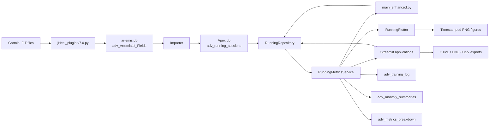

# Running Analytics Architecture

## Purpose and scope

`runAdvanced` is a local running-data ingestion, analytics, persistence, and
visualization pipeline. Its primary data store is SQLite. It has two user-facing
analysis modes:

1. A batch analysis that calculates and stores enhanced metrics and writes
   timestamped Matplotlib figures.
2. An interactive Streamlit dashboard that recalculates metrics for a selected
   date range and speed-zone set, and can export charts, a dashboard, or filtered
   data.

The enhanced modules are the current application path. The v7 database builder
and FIT parser are retained as earlier/compatibility tooling; the parser is also
the FIT ingestion step used to populate the Artemis source table expected by the
enhanced database importer.

## System context and data flow



The shared analytics boundary is a pandas `DataFrame` of sessions. The repository
normalizes source column names and dates; the metrics service derives session,
daily, and weekly values; the batch runner and dashboards then consume those
derived values. Both dashboards use the same repository and metric service rather
than maintaining separate calculation implementations.

## Runtime entry points

### FIT ingestion and database preparation

1. Run `jHeel_plugin v7.0.py` when new FIT files need to be parsed. It creates
   `artemis.db.adv_Artemistbl_Fields`, parses FIT session messages, and inserts
   parsed records. It also creates the `RunFields_view` view.
2. Run `createRunAnalDB_v8_enhanced.py` to create or extend the tables in
   `Apex.db` and import the current calendar year's running sessions.
3. Run `main_enhanced.py` for batch analytics and PNG reports, or launch one of
   the Streamlit applications for interactive analysis.

The repository README recommends these enhanced commands:

```text
python createRunAnalDB_v8_enhanced.py
python main_enhanced.py
streamlit run streamlit_app_enhanced.py
```

FIT parsing is a prerequisite when the Artemis source table has not already
been populated. The batch runner and dashboards do not parse FIT files
themselves.

### Batch analysis: `main_enhanced.py`

`main()` constructs `RunningRepository`, `RunningMetricsService`, and
`RunningPlotter`, then:

1. Loads sessions and calculates derived metrics and weekly TRIMP.
2. Returns without analysis if the loaded frame is empty.
3. Recalculates recovery/readiness, detects fatigue and overtraining anomalies,
   and adds estimated fat-burn values.
4. Replaces the enhanced training-log table with the completed session frame.
5. Calculates and upserts monthly summaries when sessions exist.
6. Calculates the aggregate training score and inserts a metrics-breakdown
   snapshot, then prints score, speed, HR-RS, and anomaly summaries.
7. Writes trend, training-load, recovery/readiness, score, speed, HR-RS,
   fat-burn, advanced, and performance-dashboard figures to the configured
   output directory.

The batch runner currently uses a fixed database path
(`c:/smakrykoDBs/Apex.db`), a fixed PNG output directory
(`c:/temp/logsFitnessApp/Run_DashBoards`), and fixed personal profile
parameters: 73.9 kg, resting HR 60 bpm, and maximum HR 190 bpm. Its
`add_fat_burn_metrics` function maps average-HR reserve to easy (<0.70),
moderate (<0.85), or hard intensity before calling the fat-burn estimator.

`RunningPlotter` also implements enhanced-metric and risk-specific plots, but
`main_enhanced.py` does not currently invoke `visualize_enhanced_metrics` or
`visualize_risk_dashboard`; risk and enhanced values are still calculated and
persisted, and are available in the Streamlit dashboard.

### Interactive dashboards

Both Streamlit applications:

- Read the configured SQLite database through `RunningRepository`.
- Accept resting and maximum heart-rate settings.
- Cache the initial load/calculation using Streamlit's data cache.
- Filter results by date range and speed zone, then recompute the aggregate
  score, monthly metrics, and anomaly summary for the selected subset.
- Present KPIs for session count, overall score, speed, TRIMP, pace, recovery,
  readiness, risk, ACWR, monotony, strain, and efficiency factor.
- Show an alert for the latest risk level.
- Provide interactive Plotly views of the selected data.

`streamlit_app_enhanced.py` has seven tabs:

| Tab | Functionality |
| --- | --- |
| Overview | Session score versus recovery/readiness and a selectable metric explorer. |
| Training Load | Session and weekly TRIMP, acute/chronic loads, ACWR, monthly mean TRIMP, monotony, and strain. |
| Speed & Pace | Average/maximum speed, pace, speed versus HR colored by risk, and speed-zone distribution. |
| Recovery | Recovery/readiness time series and score distributions. |
| Enhanced Metrics | Efficiency/performance indices, aerobic decoupling, ACWR, and risk distribution. |
| HR-RS & Anomalies | HR-RS trends and relationships, speed efficiency, fatigue-index chart, and anomaly table. |
| Data & Export | Score breakdown, monthly summary, filtered rows, SQLite persistence, HTML dashboard, selected-chart export, and filtered CSV download. |

`streamlit_app_enhanced_dashboard.py` is an extended variant. It adds an
"Enhanced Summary" tab with an explanatory metric guide, enhanced-metric
summary statistics, latest session values, monthly enhanced averages, risk
details, and efficiency/performance scatter plots. Its HTML export also includes
the enhanced-metric summary table. It otherwise follows the same data loading,
filtering, charting, persistence, and export flow.

The data-persistence buttons save the **full loaded dataset**, not just the
currently filtered subset. The display and exports use the filtered subset.
The training-log table is replaced when saved; monthly summaries are upserted
by month; a new metrics-breakdown snapshot is inserted.

### Historical recalculation: `recalculate_enhanced_history.py`

This command-line utility rebuilds enhanced metrics-breakdown snapshots for
dates found in the first column of an older CSV export. It:

- Accepts the database and CSV paths and optional raw/output table names.
- Chooses the first available raw table from `adv_running_sessions`,
  `adv_sessions`, and `running_sessions` unless one is specified.
- Loads the full history once, then limits each snapshot calculation to
  sessions before the following day, avoiding future-session leakage into
  historical scores and anomaly thresholds.
- Optionally drops and recreates the output table with `--replace`; otherwise it
  creates the table if needed and appends snapshots.
- Reports the source table, dates found, rows written, and skipped dates.

The `--replace` option is destructive to the selected output table.

## Component responsibilities

| Component | Responsibility |
| --- | --- |
| `jHeel_plugin v7.0.py` | Reads `.fit` files with `fitparse`, extracts activity/session and record data, estimates sweat loss, resolves recovery heart rate, and inserts parsed sessions into the Artemis database. |
| `createRunAnalDB_v8_enhanced.py` | Creates/migrates enhanced SQLite schemas and imports current-year running sessions from Artemis, joining Garmin activity data for speed fields. |
| `repository_enhanced.py` — `RunningRepository` | SQLite access, source-table selection, legacy-column normalization, session insertion, enhanced training-log replacement, monthly-summary upserts, and score-snapshot insertion. |
| `metrics_enhanced.py` — `RunningMetricsService` | Derived metrics, calendar training loads, recovery/readiness, aggregate and session scoring, monthly aggregation, speed/HR-RS analysis, and anomaly classification. |
| `main_enhanced.py` | Batch orchestration, fixed profile settings, fat-burn estimation, persistence, console summaries, and Matplotlib report generation. |
| `plots_enhanced.py` — `RunningPlotter` | Timestamped Matplotlib image generation for trends, loads, performance, recovery, HR-RS, fatigue, and zones. |
| `streamlit_app_enhanced.py` | Interactive Plotly dashboard, filters, score and summary views, SQLite persistence, and exports. |
| `streamlit_app_enhanced_dashboard.py` | Dashboard variant with extended metric definitions, summaries, and visual comparisons. |
| `html_export_enhanced.py` | Builds a standalone HTML dashboard containing KPI cards, notes, Plotly figures, and data tables. |
| `recalculate_enhanced_history.py` | Historical, as-of-date metrics-breakdown reconstruction from CSV snapshot dates. |
| `createRunAnalDB - v7.0.py` | Older database/import implementation. Superseded for the enhanced workflow by the v8 script. |

`Run_Dashboard.html` and `metrics_brakedown.csv` are data/report artifacts,
not executable services. The `README_*` files describe prior pipeline usage and
fixes.

## FIT parsing and source data

`jHeel_plugin v7.0.py` processes FIT messages as follows:

- It scans `.fit` files in its configured input folder and derives an activity
  identifier from each filename.
- It reads sport and timestamp fields, session duration/distance, average and
  maximum HR, calories, cadence, cycle/stride counts, elevation, running
  economy, VO2max, cardiac drift, HR-RS deviation, and available HRV-related
  fields.
- It gathers timestamped record-level HR samples for recovery calculations.
- It prefers the Garmin session recovery-HR field number 202, then recognized
  named recovery fields, and finally estimates a value from record samples near
  60 seconds after the activity end.
- It estimates sweat loss from duration, sport-specific base rates, HR-based
  intensity, and calorie rate. This is an estimate, not a measured fluid-loss
  value.
- It writes rows to `artemis.db.adv_Artemistbl_Fields` using
  `INSERT OR REPLACE`, and exposes running records through `RunFields_view`.

The parser's table-creation routine first drops and recreates
`adv_Artemistbl_Fields`. Running it therefore erases the existing parsed
source-table contents before reimporting the files it scans. Preserve or back up
the Artemis database before using it if its existing records matter.

## Database architecture

Default paths are defined in the scripts:

| Database | Default path | Role |
| --- | --- | --- |
| Artemis | `c:/smakrykoDBs/artemis.db` | FIT-derived source table and running view. |
| Apex | `c:/smakrykoDBs/Apex.db` | Normalized running sessions and enhanced analytics outputs. |
| Garmin activities | `c:/smakrykoDBs/garmin_activities.db` | Garmin activity data source expected by the importer. |

The v8 importer joins Artemis activities with the `activities` table for
`avg_speed` and `max_speed`, filters to running sports and the current calendar
year, and inserts/replaces matching activity IDs in Apex. Before import, it
attempts to delete rows for the current year from `adv_running_sessions`, then
imports that year's results. The delete is committed when rows are imported;
when the source query returns no rows, the script only prints a warning and
closes the connection without committing, so SQLite may roll back that delete.
Older years are not refreshed by this step.

The importer defines and opens a connection for the Garmin database, but the
current query's `activities` join is issued through the Artemis cursor. The
database containing `activities` therefore needs to match where that query
actually runs; the separate Garmin connection is not used by the query as
written.

The enhanced SQLite tables are:

| Table | Contents and update behavior |
| --- | --- |
| `adv_running_sessions` | Imported/raw session facts, optional recovery and split inputs, Garmin/FIT support fields, and legacy aliases such as `cardiacdrift` and `HR_RS_Deviation_Index`. Keyed by `activity_id`. |
| `adv_training_log` | Session-level raw and calculated columns, including load, efficiency, recovery/readiness, anomaly flags, and risk level. Replaced by the batch runner or dashboard persistence action. |
| `adv_monthly_summaries` | Per-month session count plus mean, standard deviation, and count for supported metrics. Upserted by `year_month`. |
| `adv_metrics_breakdown` | Aggregate score, normalized/weighted and raw score components, trends, and descriptive speed/load/efficiency statistics. Snapshots are appended. |

The repository selects a non-empty raw table in this preference order:
`adv_running_sessions`, `adv_sessions`, then `running_sessions`. If all
available candidates are empty, it logs a warning and uses the first existing
table. A caller can explicitly provide `raw_table`, in which case a missing
table raises an error.

The repository normalizes these source-name pairs:

- `date` or `timestamp` to `date`.
- `hr_rs_deviation` or `HR_RS_Deviation_Index` to `hr_rs_deviation`.
- `cardiac_drift` or `cardiacdrift` to `cardiac_drift`.
- `activity_id` or `id` to an activity identifier.

Invalid dates are dropped with a warning. Missing optional source columns are
selected as null or zero defaults so older source schemas can still be read.

## Analytics and derived metrics

The analytics service expects session duration in minutes and average speed in
km/h. It parses dates, sorts sessions chronologically, fills unavailable core
numeric metrics with zero, and adds derived values. Values are computed in
memory by `load_training_log`; some are persisted in `adv_training_log`.

### Session-level performance metrics

- **Duration:** `duration_min` is the non-negative input `time`; `duration_hr`
  is minutes divided by 60.
- **Efficiency score:** running economy divided by VO2max when VO2max is
  positive.
- **Energy cost:** running economy multiplied by distance divided by duration
  when duration is positive.
- **Speed reserve:** maximum speed minus average speed.
- **Speed consistency:** average speed divided by maximum speed.
- **Pace:** `60 / avg_speed` minutes per kilometer when speed is positive.
- **Speed efficiency / efficiency factor:** average speed divided by heart rate.
- **Economy at speed:** running economy divided by average speed.
- **Speed-VO2max index:** average speed multiplied by VO2max.
- **Performance index:** average speed multiplied by running economy divided
  by heart rate.
- **Physiological efficiency:** average speed divided by HR and positive
  HR-RS deviation.
- **Fatigue index:** non-negative HR-RS deviation times non-negative cardiac
  drift, divided by average speed. Negative drift does not reduce the index.
- **Speed zone:** Slow for speeds through 10 km/h, Moderate through 14 km/h,
  and Fast above 14 km/h.
- **Estimated fat burn:** intensity uses the run's HR reserve ratio (easy below
  0.70, moderate below 0.85, otherwise hard). Estimated energy is
  `distance_km * weight_kg * 1.036` kcal; the estimator assigns 65%, 50%, or
  25% of that energy to fat for easy, moderate, or hard intensity, then divides
  fat-derived kcal by 9 to estimate grams. Its reported oxidation rate is a
  percentage string.

### Training load and calendar aggregation

- **HR ratio:** `(average HR - resting HR) / (maximum HR - resting HR)`, clipped
  to 0–1. The denominator is protected against non-positive ranges.
- **TRIMP:** duration in minutes multiplied by the clipped HR ratio.
- **Daily TRIMP:** session TRIMP summed by normalized calendar day, with
  zero-load days included in the daily series.
- **Acute load:** sum of daily TRIMP over a trailing seven-calendar-day window.
- **Chronic load:** sum over a trailing 28-calendar-day window.
- **ACWR 7/28:** acute load divided by the 28-day sum expressed as a
  four-week-average baseline (`chronic_load_28d / 4`).
- **Weekly monotony:** trailing seven-day mean daily TRIMP divided by its
  standard deviation; invalid or zero-variance results become zero.
- **Weekly strain:** acute 7-day load multiplied by weekly monotony.
- **Weekly TRIMP:** TRIMP summed by ISO year/week. The service also calculates a
  legacy weekly acute/chronic/ACWR series, where chronic load is the rolling
  four-week mean of weekly TRIMP.
- **Rolling values:** seven-calendar-day means for TRIMP, speed, and HR-RS
  deviation. If valid dates are unavailable, the helper falls back to the
  previous seven rows/sessions.

### Aerobic decoupling

When first- and second-half heart rate and speed are supplied, the service
calculates the percentage change in the HR-to-speed ratio between halves.
Missing or invalid split-based results fall back to the source cardiac-drift
value. The dashboard labels this as aerobic decoupling / cardiac-drift proxy.

### Recovery and readiness

Available inputs are normalized to 0–1 and weighted:

- Resting-HR score is relative to the mean resting HR in the loaded data.
- Load score compares session TRIMP with a four-session rolling mean.
- Sleep score is sleep quality divided by 5.
- Fatigue score is one minus fatigue level divided by 10.
- Recovery weights resting HR 30%, load 30%, sleep 20%, and fatigue 20%.
- Readiness weights recovery 50%, load 30%, and sleep 20%.

Missing component signals are excluded and the remaining weights are
renormalized. Specifically, resting-HR score is `1 - (session resting HR -
loaded-data mean resting HR) / loaded-data mean resting HR`, and load score is
`1 - session TRIMP / trailing four-session mean TRIMP`; both are clipped to
0–1. If the source data has no recovery, sleep, or fatigue inputs, these scores
are largely or entirely load-based; the current v8 importer sets those optional
inputs to null.

### Training scores and analysis summaries

Fixed reference ranges make scores stable when new best/worst sessions are
added. Values are clipped to the reference bounds, mapped to 0–1, inverted
where lower is better, then weighted:

| Metric | Range | Weight | Direction |
| --- | --- | ---: | --- |
| Running economy | 100–300 | 25% | Higher is better |
| VO2max | 30–65 | 20% | Higher is better |
| Distance (km) | 0–30 | 15% | Higher is better |
| Efficiency score | 0–8 | 20% | Higher is better |
| Heart rate | 120–190 | 20% | Lower is better |

The overall score is the weighted normalized mean multiplied by 100. The
service also exposes per-session scores, metric means and standard deviations,
and correlations between date and normalized running-economy/distance values.
Speed analysis reports speed/pace statistics, zones, and (with enough
sessions) early-to-recent speed change. HR-RS analysis reports distribution and
stability, recent change, and correlations when sample counts are sufficient.
Monthly summaries aggregate supported performance, load, recovery, and
efficiency metrics as mean, standard deviation, and count.

### Fatigue and overtraining classification

`detect_anomalies` derives an HR-RS z-score using population standard deviation
and associates weekly ACWR values with sessions. It uses the selected frame's
90th-percentile fatigue index and an HR-RS threshold of
`max(5, 1.2 * frame median)` alongside recovery/readiness scores.

- A **fatigue flag** is set for low recovery (<0.45), low readiness (<0.50),
  HR-RS z-score >1.5, HR-RS deviation above its relative threshold, fatigue
  index above the frame's 90th percentile, or weekly monotony >2.
- An **overtraining flag** is set for ACWR >1.3; or ACWR >1.5 with weekly
  strain above its 75th percentile; or recovery <0.35 together with readiness
  <0.45; or HR-RS deviation above its relative threshold while speed is below
  its rolling five-session mean.
- Risk is **High** when overtraining is flagged, otherwise **Medium** when
  fatigue is flagged, otherwise **Low**.

The method returns the annotated frame and a summary containing flag counts,
latest risk indicators, and latest ACWR/monotony/strain. These are heuristic
training indicators, not medical diagnoses. Since thresholds are calculated
from the frame supplied to the method, results can vary with dashboard filters
or historical as-of-date subsets.

## Visualization and export

### Matplotlib batch reports

`RunningPlotter` saves timestamped 300-DPI PNG files and calls `plt.show()`.
Its methods produce:

- Running-economy and efficiency trends; energy-cost/distance and HR/economy
  comparisons.
- Session and weekly TRIMP, calendar acute/chronic loads, ACWR, monotony, and
  strain.
- Recovery/readiness time series and session-score comparisons.
- Speed, speed reserve, speed/HR, speed efficiency, pace, and zone charts.
- HR-RS time series, distribution, speed relationship, and TRIMP relationship.
- Per-run and cumulative estimated fat-burn chart.
- Advanced cumulative-distance, moving-average, pace/HR, zone distribution,
  normalized radar, and month-of-year heatmap views.
- A consolidated performance dashboard, plus dedicated enhanced-metric and
  risk dashboards.

### Streamlit and HTML exports

The dashboards build Plotly figures for interactive display and export. The
user can:

- Export the full dashboard as timestamped HTML with KPI cards, notes, chart
  embeds, and tables. Plotly JavaScript is loaded from a CDN.
- Export one selected Plotly chart as HTML and attempt a 1400-by-800 PNG.
  PNG export requires Plotly's image-export dependency (Kaleido); if it is
  unavailable, HTML is still written and the dashboard reports that the PNG
  could not be produced.
- Download the currently filtered session frame as CSV.
- Persist the full enhanced frame, monthly summaries, and aggregate score
  breakdown to SQLite.

`html_export_enhanced.py` is the shared standalone HTML builder. It creates the
output folder if absent, embeds title, generation time, optional notes, KPI
cards, figures, and pandas tables, and returns the generated file path.

## Configuration, units, and operational assumptions

- Database and export paths are hard-coded defaults in the scripts; the
  Streamlit sidebars allow the dashboard database and export-folder paths to be
  changed at runtime.
- The dashboards default to resting HR 60 and maximum HR 190, with sidebar
  ranges of 30–120 and 100–240 respectively.
- `RunningMetricsService` assumes `time` is minutes and `avg_speed` is km/h.
  The v8 importer currently maps FIT `total_elapsed_time` directly to `time`
  without an explicit seconds-to-minutes conversion. Confirm the source's time
  unit before relying on duration-based TRIMP, energy cost, or time-derived
  metrics.
- `jHeel_plugin v7.0.py` writes FIT `total_elapsed_time` as supplied. Its
  estimated sweat-loss helper treats this value as seconds, which is consistent
  with typical FIT elapsed-time fields but distinct from the analytics
  service's stated minute assumption.
- The v8 importer reads `CURRENT_YEAR` at execution time and refreshes only
  rows in that year. Historical data requires a different import process.
- The v8 importer catches SQLite errors, rolls back the Apex connection, and
  reports them to stdout. Missing source schema or required columns are
  rejected before import.
- Optional recovery/readiness inputs and first/second-half splits are not
  populated by the current importer; they must be supplied by another source
  or user process to contribute those signals.
- The repository supports the legacy `running_sessions` and `adv_sessions`
  table names and legacy HR-RS/cardiac-drift column aliases.

## Legacy and supporting files

- `createRunAnalDB - v7.0.py` is the earlier schema/import path. It creates or
  extends `adv_running_sessions`, imports current-year rows, and retains the
  older raw column naming. Use the v8 enhanced builder for the enhanced schema
  and derived-output tables.
- `metrics_brakedown.csv` is an older score export, and
  `recalculate_enhanced_history.py` can use its first-column dates as snapshot
  dates. The CSV's spelling and format are preserved as an input compatibility
  concern.
- `Run_Dashboard.html` is a pre-generated/static dashboard artifact. It is not
  automatically refreshed by running the Python pipeline.
- `README_enhanced_pipeline.md` documents the suggested run order and enhanced
  table names. Other README files record earlier corrections and should be
  treated as historical implementation notes.

## Dependencies and extension points

The code imports pandas and NumPy for data transformation, SQLite through
Python's standard library, Matplotlib for batch charts, Plotly and Streamlit
for the interactive dashboard and HTML reports, and `fitparse` for FIT-file
ingestion. Plotly PNG export additionally depends on Kaleido.

The primary extension boundaries are:

- Add or normalize raw data fields in the FIT parser/importer and repository
  schema.
- Add derived metrics in `RunningMetricsService.load_training_log` or a
  closely related service method, then add the field to the output schema when
  it must be persisted.
- Add batch figures to `RunningPlotter` and call them from `main_enhanced.py`.
- Add interactive views to either Streamlit application; place shared data
  access and calculations in the repository/service rather than duplicating
  formulas in the UI.
- Add monthly or score-breakdown fields in both the service aggregation and
  `RunningRepository` table definitions so database inserts remain aligned.
